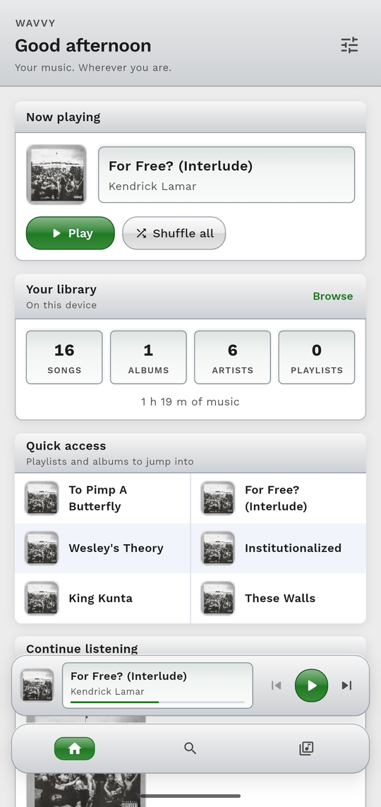
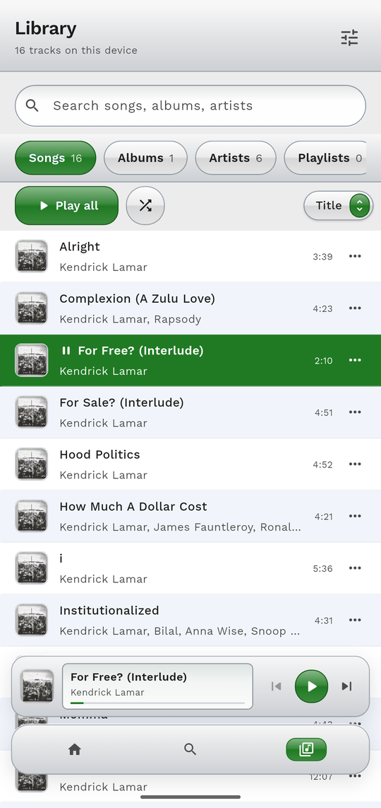
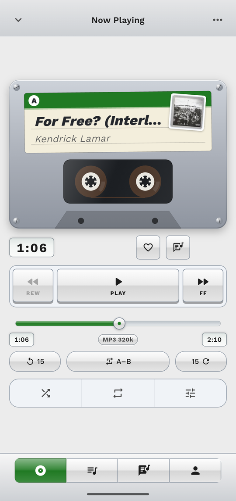
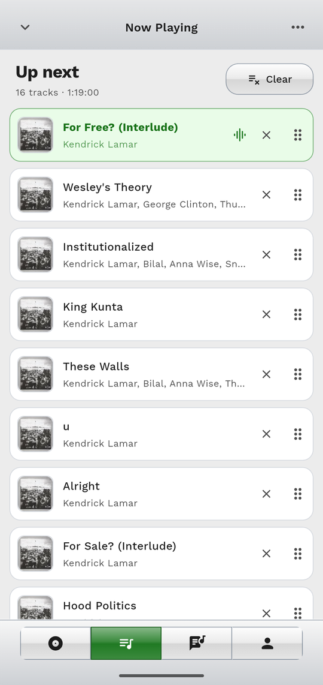
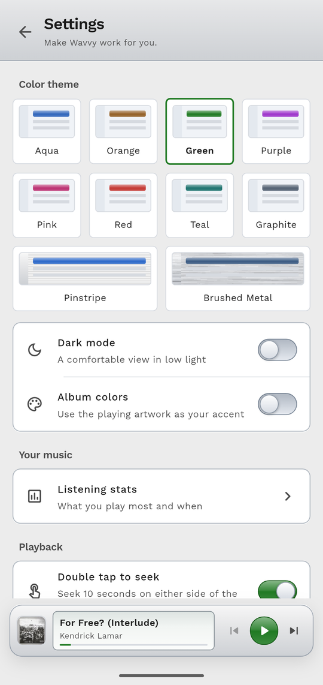

<h1 align="center">Wavvy</h1>

<p align="center">
  <strong>A beautiful offline music player for Android, with synced lyrics, a real equalizer and the glossy Mac OS X Aqua look.</strong>
</p>

<p align="center">
  Android · Made with Flutter · Sibling of <a href="https://github.com/mirimomekiku/kaisu">Kaisu</a>
</p>

<p align="center">
  
  
  
  
</p>

Wavvy plays the music already on your phone. When you're online it can add synced lyrics, artist stories and missing album
covers. Nothing is uploaded, and there are no accounts or ads.

---

## Highlights

- **Your music, beautifully.** Silver toolbars, gel buttons and a recessed display bring the classic Aqua style to your phone.
- **A player with personality.** Choose how Now Playing looks: a spinning vinyl record, a cassette deck, a CD player, an iTunes-style
  display, Cover Flow, a hi-fi deck, a poster, and more.
- **Sound you can shape.** A five-band equalizer with 19 presets, bass boost, reverb and a volume boost.
- **Lyrics that follow along.** Tap a line to jump to it, or go full screen.
- **Made for long listening.** Gapless playback, a sleep timer that fades out gently, and a queue that's still there when you come back.

---

## Listening

<table>
  <tr>
    <td width="50%" valign="top">

- **Plays everything** your phone can: MP3, FLAC, M4A, WAV and more, gapless.
- **Background playback** with notification and lock-screen controls, plus optional Like, Shuffle and Repeat buttons.
- **A queue you control.** Play next, add, reorder, remove, or pick several songs at once and save them as a playlist.
- **Shuffle that's actually smart.** It keeps an artist's songs apart and favors songs you like.
- **Sleep timer** by minutes, end of the track, a number of tracks or the end of the queue, with a fade-out. Shake the phone to add more time.
- **Speed and pitch**, remembered for each album, plus A–B looping and 15-second skips.
- **Pick up where you left off.** Wavvy reopens with your queue and position.

</td>
    <td width="50%" valign="top">

- **Equalizer and effects.** Presets, your own saved presets, bass boost, virtualizer, reverb and a volume boost.
- **Even volume.** Songs with ReplayGain tags play at a matching loudness, and crossfade is available as an experiment.
- **Know what you're hearing.** A quality badge shows the format, bitrate and whether a song is lossy, lossless or Hi-Res.
- **Open with Wavvy.** Play audio files straight from your file manager or another app.
- **Favorites** with a Liked songs list, and a **home-screen widget**.
- **Volume-key skipping** (off by default): hold volume up for the next song and volume down for the previous one while Wavvy is open.

</td>
  </tr>
</table>

---

## Your library


- **Songs, albums, artists and playlists** with quick search, filtering and sorting.
- **Multi-disc albums** are grouped as Disc 1, Disc 2 and so on, and play in the right order.
- **Home shelves** such as *Continue listening* and *Rediscover*, which brings back songs you haven't played in a while.
- **Select several songs** to play, queue, add to a playlist, like, share or delete them together.
- **Listening stats.** See your top songs, artists and albums and a two-week activity chart. Incognito mode pauses history, and you
  can clear it at any time.
- **Edit tags** such as title, artist, album, year and genre.
- **Find missing covers** from MusicBrainz and the Cover Art Archive. This is off by default, sends only album and artist names, and
  never changes your music files.
- **Fast scrolling** on long lists, with a letter bubble when you scrub.

<br clear="right">

---

## Make it yours



- **Eight colour themes:** Aqua, Orange, Green, Purple, Pink, Red, Teal and Graphite, each in light and dark.
- **Pinstripe** (Mac OS X Panther) and **Brushed Metal** (Tiger) looks.
- **Material You** colours from your wallpaper, if you prefer.
- **Album colors** tint the whole app from the artwork that's playing.
- **Seven Now Playing layouts,** plus a two-pane view that appears by itself on tablets and in landscape.
- **Share a card.** Turn the current song into an image in an Aqua, Poster or Minimal style, or share your favorite lyric lines. It all
  happens on your device.

<br clear="left">

---

## Lyrics and artists

- **Synced lyrics** from [LRCLib](https://lrclib.net), with a full-screen mode, adjustable text size and a screen that stays awake.
- **Artist pages** with biographies and photos from Genius, alongside everything of theirs in your library.

---

## Two versions

Wavvy comes in two flavors, so you can pick the one that suits you.

| | **Play** | **Full** |
| --- | --- | --- |
| Offline player, lyrics, equalizer, themes | ✅ | ✅ |
| Search online and download audio with [yt-dlp](https://github.com/yt-dlp/yt-dlp) | – | ✅ |
| Live spectrum visualizer (needs the microphone permission; nothing is recorded) | – | ✅ |
| Made for | Play Store | Sideloading |

Downloaded songs are tagged with a title, artist and cover, and saved to `Music/Wavvy`. More in [docs/flavors.md](docs/flavors.md).

---

## Permissions

Wavvy asks only for what it needs: access to your music so it can list it, and notifications for playback controls. Editing tags or
deleting a song uses Android's own confirmation each time, so no standing permission is needed.

---

## Build it yourself

```sh
flutter pub get
flutter run --flavor full      # or: --flavor play
flutter build apk --flavor full --release
```

Artist information needs a Genius token: put `GENIUS_ACCESS_TOKEN=...` in a `.env` file at the project root (it is gitignored).

Handy docs: [architecture](docs/architecture.md), [flavors](docs/flavors.md), [playback](docs/playback.md) and the
[Aqua design notes](docs/kaisu-companion-redesign.md). Run `flutter analyze` and `flutter test` before sending changes.
